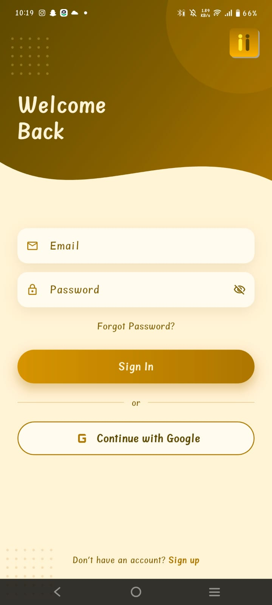
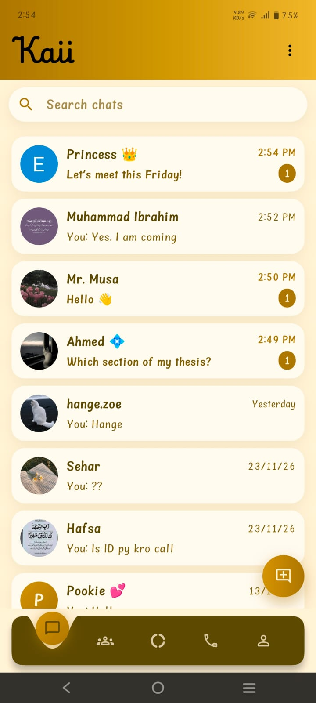
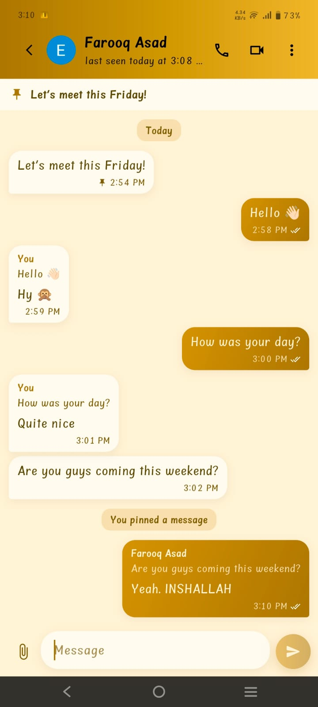
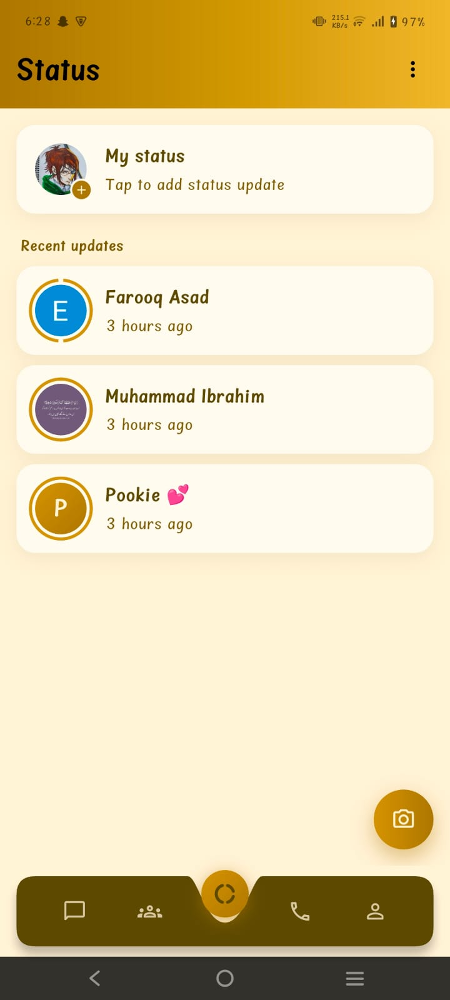
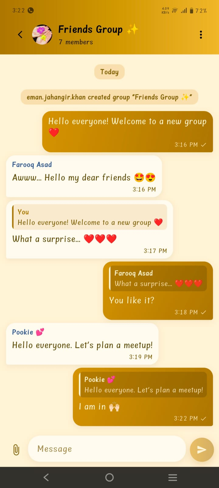
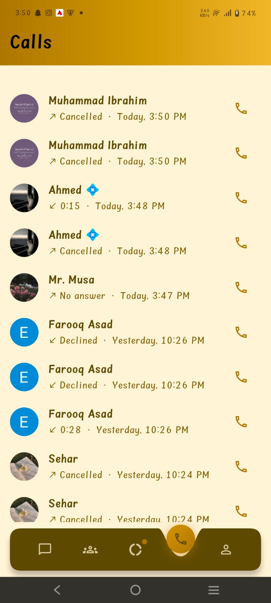

# 💬 Kaii

**Kaii** is a WhatsApp-style real-time chatting app built with **Flutter** and **Firebase**. It supports one-to-one chats, group chats, 24-hour status stories, photo/video sharing, push notifications, and voice/video calls.

---

## ✨ Features

### 🔐 Authentication
- Sign up / login with email and password
- Google Sign-In
- Email verification
- Unique username chosen after sign-up
- Delete account (username is freed for others; deleted users show as "Unknown user")

### 💬 One-to-One Chat
- Real-time messaging
- Find users by username, send a chat request, and message once accepted
- Cancel a pending request
- Forward messages to other chats
- Block / unblock users
- Online status and last seen
- Push notifications for new messages

### 👥 Group Chat
- Create groups and add members
- Group info screen
- Message info (who has seen a message)
- Forward messages to groups

### 📸 Media Sharing
- Share photos and videos in chats and groups
- Pick from a photo/video gallery picker or capture with Camera
- Crop images before sending
- Full-screen photo viewer and video player
- Media stored on Cloudinary

### 🟢 Status (Stories)
- 24-hour status as image, video, or text
- Visibility control: all contacts / only selected / all contacts except selected
- Full-screen viewer with auto-play to the next contact
- "Viewed by" list with likes
- Reply to a status (goes to the owner's chat with the status quoted)

### 📞 Calls
- Voice and video calls using Agora
- Incoming call screen (works like a normal phone call)
- Minimize call banner
- Call history screen and call log inside chats

### 👤 Profile & Contacts
- Edit nickname
- Change username (once every 7 days, must be unique)
- Private saved name for each contact
- Contact info: shared media, groups in common, block option

---

## 🛠️ Tech Stack

| Area | Technology |
|------|------------|
| Framework | Flutter (Dart) |
| Authentication | Firebase Authentication, Google Sign-In |
| Database | Cloud Firestore |
| Notifications | Firebase Cloud Messaging, flutter_local_notifications |
| Media Storage | Cloudinary |
| Calls | Agora RTC Engine, flutter_callkit_incoming |
| State Management | Provider |
| Media | image_picker, wechat_assets_picker, image_cropper, video_player, cached_network_image |

---

## 📸 Screenshots

> Add your screenshots in a `screenshots/` folder and link them here.

| Login                            | Chats                            | Chat Screen                    |
|----------------------------------|----------------------------------|--------------------------------|
|  |  |  |

| Status                             | Group Chat                       | Calls                            |
|------------------------------------|----------------------------------|----------------------------------|
|  |  |  |

---

## 🚀 Getting Started

### Prerequisites
- Flutter SDK installed
- A Firebase project
- A Cloudinary account
- An Agora account

### Installation

1. **Clone the repository**
   ```bash
   git clone https://github.com/Eman-Jahangir-Khan/kaii.git
   cd kaii
   ```

2. **Install dependencies**
   ```bash
   flutter pub get
   ```

3. **Set up Firebase**
   - Create a project in the [Firebase Console](https://console.firebase.google.com/)
   - Enable **Authentication** (Email/Password and Google), **Cloud Firestore** and **Cloud Messaging**
   - Add your Android app and download `google-services.json` (place it in `android/app/`)
   - Add the Firestore security rules from your `rules.js` file

4. **Set up Cloudinary**
   - Create an unsigned upload preset
   - Add your cloud name and upload preset in `lib/cloudinary_service.dart`

5. **Set up Agora**
   - Create a project and copy the App ID
   - Add it in the app's config file

6. **Run the app**
   ```bash
   flutter run
   ```

> ⚠️ Never upload secret keys to GitHub. Keep private keys out of the repository.

---

## 📂 Project Structure

```
lib/
├── main.dart
├── theme.dart
├── auth_repository.dart
├── chat_repository.dart
├── group_repository.dart
├── status_repository.dart
├── call_repository.dart
├── cloudinary_service.dart
├── notification_service.dart
├── presence_service.dart
├── ...
└── screens/
    ├── login_screen.dart
    ├── signup_screen.dart
    ├── home_screen.dart
    ├── chat_screen.dart
    ├── group_chat_screen.dart
    ├── status_screen.dart
    ├── call_screen.dart
    ├── profile_screen.dart
    └── ...
```

---

## 🔮 Future Improvements
- Voice messages
- More Message reactions
- Better notifications
- Mute Notification

---

## 👩‍💻 Author

**Eman Jahangir Khan**
BS Information Technology, University of the Punjab
Flutter Developer

- GitHub: Eman-Jahangir-Khan (https://github.com/Eman-Jahangir-Khan)
- LinkedIn: Eman Jahangir Khan (https://linkedin.com/in/eman-jahangir-khan-99b2b537a)

---

⭐ If you like this project, give it a star!